# Как подобрать

Как выбрать материал под задачу: таблица ниже связывает задачу, позицию РДР, ограничение и цену "от". Компания не фиксирует назначение позиций на сайте, поэтому связки задача - материал даны как ориентир по общей строительной практике, у компании не зафиксировано.

Задача документа: позиции прайса и назначение по данным клиента.

## Задача -> что брать

| Задача | Что брать | Ограничение | Цена от | Источник |
|---|---|---|---|---|
| отсыпка участка, дорожки, дорога, парковка, основание | Щебень известняковый | ниже прочность и морозостойкость, чем у гранита; для ответственного бетона не берут | от 1750 руб/м3 | общая строительная практика |
| фундамент, бетон, дорога, парковка | Щебень гранитный | дороже известнякового; для легкой отсыпки избыточен | от 5200 руб/м3 | общая строительная практика |
| бетон, фундамент, дренаж, дорога | Щебень гравийный | окатанная форма хуже держит насыпь, чем колотый щебень | от 3600 руб/м3 | общая строительная практика |
| отсыпка участка, дорога, подсыпка | Щебень шлаковый | состав зависит от партии; для жилых помещений уточнять документы | от 1200 руб/м3 | общая строительная практика |
| отсыпка участка, дорожки, бетон | Щебень доломитовый | по прочности ближе к известняковому | от 2990 руб/м3 | общая строительная практика |
| подушка, фундамент, засыпка, отсыпка участка | Песок горный | может содержать глинистые примеси; для бетона и раствора лучше мытый или речной | от 800 руб/м3 | общая строительная практика |
| бетон, кладка, раствор, штукатурка, стяжка | Песок речной | дороже карьерного | от 1300 руб/м3 | общая строительная практика |
| подушка, стяжка, засыпка, бетон | Песок гидронамывной | мелкая фракция; для кладки уточнять модуль крупности | от 1200 руб/м3 | общая строительная практика |
| дорожки, подсыпка под плитку, отсыпка участка | Мучка известняковая | мелкая фракция, для бетона не основной заполнитель | от 750 руб/м3 | общая строительная практика |
| дорожки, подсыпка под плитку, отсыпка участка | Мучка шлаковая | мелкая фракция, для бетона не основной заполнитель | от 1000 руб/м3 | общая строительная практика |
| кладка, стяжка, штукатурка | Раствор М150 | марка выбирается по нагрузке и проекту | от 5350 руб/м3 | общая строительная практика |
| кладка, стяжка, штукатурка | Раствор М200 | марка выбирается по нагрузке и проекту | от 5800 руб/м3 | общая строительная практика |
| подготовка (подбетонка), неответственные основания | Бетон на известняковом щебне В7,5 (П3) П4 | класс выбирается по проекту | от 5080 руб/м3 | общая строительная практика |
| стяжки, дорожки, отмостки | Бетон на известняковом щебне В15 (П3) П4 | класс выбирается по проекту | от 5530 руб/м3 | общая строительная практика |
| фундаменты частных домов, площадки | Бетон на известняковом щебне В20 (П3) П4 | класс выбирается по проекту | от 5620 руб/м3 | общая строительная практика |
| фундаменты частных домов, площадки | Бетон на известняковом щебне В22,5 (П3) П4 | класс выбирается по проекту | от 5700 руб/м3 | общая строительная практика |
| стяжки, дорожки, отмостки | Бетон на гранитном щебне В15 (П3) П4 | класс выбирается по проекту | от 7560 руб/м3 | общая строительная практика |
| фундаменты частных домов, площадки | Бетон на гранитном щебне В20 (П3) П4 | класс выбирается по проекту | от 7650 руб/м3 | общая строительная практика |
| фундаменты частных домов, площадки | Бетон на гранитном щебне В22,5 (П3) П4 | класс выбирается по проекту | от 7830 руб/м3 | общая строительная практика |
| нагруженные фундаменты, перекрытия, монолитные конструкции | Бетон на гранитном щебне В25 (П3) П4 | класс выбирается по проекту | от 8100 руб/м3 | общая строительная практика |
| нагруженные фундаменты, перекрытия, монолитные конструкции | Бетон на гранитном щебне В30 (П3) П4 | класс выбирается по проекту | от 8190 руб/м3 | общая строительная практика |

Строки с источником "общая строительная практика" - ориентир по общей строительной практике, у компании не зафиксировано. Окончательный выбор материала, класса и фракции подтверждает компания или проект.

## Схема подбора

```mermaid
flowchart LR
  T0["отсыпка участка"] --> P0_0["Щебень известняковый"]
  T0["отсыпка участка"] --> P0_1["Щебень шлаковый"]
  T0["отсыпка участка"] --> P0_2["Щебень доломитовый"]
  T0["отсыпка участка"] --> P0_3["Песок горный"]
  T1["дорожки"] --> P1_0["Щебень известняковый"]
  T1["дорожки"] --> P1_1["Щебень доломитовый"]
  T1["дорожки"] --> P1_2["Мучка известняковая"]
  T1["дорожки"] --> P1_3["Мучка шлаковая"]
  T2["дорога"] --> P2_0["Щебень известняковый"]
  T2["дорога"] --> P2_1["Щебень гранитный"]
  T2["дорога"] --> P2_2["Щебень гравийный"]
  T2["дорога"] --> P2_3["Щебень шлаковый"]
  T3["парковка"] --> P3_0["Щебень известняковый"]
  T3["парковка"] --> P3_1["Щебень гранитный"]
  T4["основание"] --> P4_0["Щебень известняковый"]
  T5["фундамент"] --> P5_0["Щебень гранитный"]
  T5["фундамент"] --> P5_1["Щебень гравийный"]
  T5["фундамент"] --> P5_2["Песок горный"]
  T6["бетон"] --> P6_0["Щебень гранитный"]
  T6["бетон"] --> P6_1["Щебень гравийный"]
  T6["бетон"] --> P6_2["Щебень доломитовый"]
  T6["бетон"] --> P6_3["Песок речной"]
  T7["дренаж"] --> P7_0["Щебень гравийный"]
  T8["подсыпка"] --> P8_0["Щебень шлаковый"]
  T9["подушка"] --> P9_0["Песок горный"]
  T9["подушка"] --> P9_1["Песок гидронамывной"]
  T10["засыпка"] --> P10_0["Песок горный"]
  T10["засыпка"] --> P10_1["Песок гидронамывной"]
  T11["кладка"] --> P11_0["Песок речной"]
  T11["кладка"] --> P11_1["Раствор М150"]
  T11["кладка"] --> P11_2["Раствор М200"]
  T12["раствор"] --> P12_0["Песок речной"]
  T13["штукатурка"] --> P13_0["Песок речной"]
  T13["штукатурка"] --> P13_1["Раствор М150"]
  T13["штукатурка"] --> P13_2["Раствор М200"]
  T14["стяжка"] --> P14_0["Песок речной"]
  T14["стяжка"] --> P14_1["Песок гидронамывной"]
  T14["стяжка"] --> P14_2["Раствор М150"]
  T14["стяжка"] --> P14_3["Раствор М200"]
  T15["подсыпка под плитку"] --> P15_0["Мучка известняковая"]
  T15["подсыпка под плитку"] --> P15_1["Мучка шлаковая"]
  T16["подготовка (подбетонка), неответственные основания"] --> P16_0["Бетон на известняковом щебне В7,5 (П3) П4"]
  T17["стяжки, дорожки, отмостки"] --> P17_0["Бетон на известняковом щебне В15 (П3) П4"]
  T17["стяжки, дорожки, отмостки"] --> P17_1["Бетон на гранитном щебне В15 (П3) П4"]
  T18["фундаменты частных домов, площадки"] --> P18_0["Бетон на известняковом щебне В20 (П3) П4"]
  T18["фундаменты частных домов, площадки"] --> P18_1["Бетон на известняковом щебне В22,5 (П3) П4"]
  T18["фундаменты частных домов, площадки"] --> P18_2["Бетон на гранитном щебне В20 (П3) П4"]
  T18["фундаменты частных домов, площадки"] --> P18_3["Бетон на гранитном щебне В22,5 (П3) П4"]
  T19["нагруженные фундаменты, перекрытия, монолитные конструкции"] --> P19_0["Бетон на гранитном щебне В25 (П3) П4"]
  T19["нагруженные фундаменты, перекрытия, монолитные конструкции"] --> P19_1["Бетон на гранитном щебне В30 (П3) П4"]
```

Текстом: для задачи "отсыпка участка" - Щебень известняковый или Щебень шлаковый или Щебень доломитовый или Песок горный; для задачи "дорожки" - Щебень известняковый или Щебень доломитовый или Мучка известняковая или Мучка шлаковая; для задачи "дорога" - Щебень известняковый или Щебень гранитный или Щебень гравийный или Щебень шлаковый; для задачи "парковка" - Щебень известняковый или Щебень гранитный; для задачи "основание" - Щебень известняковый; для задачи "фундамент" - Щебень гранитный или Щебень гравийный или Песок горный; для задачи "бетон" - Щебень гранитный или Щебень гравийный или Щебень доломитовый или Песок речной; для задачи "дренаж" - Щебень гравийный; для задачи "подсыпка" - Щебень шлаковый; для задачи "подушка" - Песок горный или Песок гидронамывной; для задачи "засыпка" - Песок горный или Песок гидронамывной; для задачи "кладка" - Песок речной или Раствор М150 или Раствор М200; для задачи "раствор" - Песок речной; для задачи "штукатурка" - Песок речной или Раствор М150 или Раствор М200; для задачи "стяжка" - Песок речной или Песок гидронамывной или Раствор М150 или Раствор М200; для задачи "подсыпка под плитку" - Мучка известняковая или Мучка шлаковая; для задачи "подготовка (подбетонка), неответственные основания" - Бетон на известняковом щебне В7,5 (П3) П4; для задачи "стяжки, дорожки, отмостки" - Бетон на известняковом щебне В15 (П3) П4 или Бетон на гранитном щебне В15 (П3) П4; для задачи "фундаменты частных домов, площадки" - Бетон на известняковом щебне В20 (П3) П4 или Бетон на известняковом щебне В22,5 (П3) П4 или Бетон на гранитном щебне В20 (П3) П4 или Бетон на гранитном щебне В22,5 (П3) П4; для задачи "нагруженные фундаменты, перекрытия, монолитные конструкции" - Бетон на гранитном щебне В25 (П3) П4 или Бетон на гранитном щебне В30 (П3) П4.

## Цены "от"

| Позиция | Цена от | Единица | Зона | Страница |
|---|---|---|---|---|
| Щебень известняковый | 1750 руб | м3 | Тула | https://rdr71.ru/prices/#prise1 |
| Щебень гранитный | 5200 руб | м3 | Тула | https://rdr71.ru/prices/#prise1 |
| Щебень гравийный | 3600 руб | м3 | Тула | https://rdr71.ru/prices/#prise1 |
| Щебень шлаковый | 1200 руб | м3 | Тула | https://rdr71.ru/prices/#prise1 |
| Щебень доломитовый | 2990 руб | м3 | Тула | https://rdr71.ru/prices/#prise1 |
| Песок горный | 800 руб | м3 | Тула | https://rdr71.ru/prices/#prise1 |
| Песок речной | 1300 руб | м3 | Тула | https://rdr71.ru/prices/#prise1 |
| Песок гидронамывной | 1200 руб | м3 | Тула | https://rdr71.ru/prices/#prise1 |
| Мучка известняковая | 750 руб | м3 | Тула | https://rdr71.ru/prices/#prise1 |
| Мучка шлаковая | 1000 руб | м3 | Тула | https://rdr71.ru/prices/#prise1 |
| Самосвал, вместимость 20 м3 | 2500 руб | ч | Тула | https://rdr71.ru/prices/#prise1 |
| Самосвал,вместимость 35 м3 | 3000 руб | ч | Тула | https://rdr71.ru/prices/#prise1 |
| Экскаватор погрузчик | 3000 руб | ч | Тула | https://rdr71.ru/prices/#prise1 |
| Фронтальный погрузчик | 3000 руб | ч | Тула | https://rdr71.ru/prices/#prise1 |
| Полноповоротный экскаватор на гусеничном ходу | 3000 руб | ч | Тула | https://rdr71.ru/prices/#prise1 |
| Раствор М150 | 5350 руб | м3 | Тула | https://rdr71.ru/prices/#prise1 |
| Раствор М200 | 5800 руб | м3 | Тула | https://rdr71.ru/prices/#prise1 |
| Бетон на известняковом щебне В7,5 (П3) П4 | 5080 руб | м3 | Тула | https://rdr71.ru/prices/#prise1 |
| Бетон на известняковом щебне В15 (П3) П4 | 5530 руб | м3 | Тула | https://rdr71.ru/prices/#prise1 |
| Бетон на известняковом щебне В20 (П3) П4 | 5620 руб | м3 | Тула | https://rdr71.ru/prices/#prise1 |
| Бетон на известняковом щебне В22,5 (П3) П4 | 5700 руб | м3 | Тула | https://rdr71.ru/prices/#prise1 |
| Бетон на гранитном щебне В15 (П3) П4 | 7560 руб | м3 | Тула | https://rdr71.ru/prices/#prise1 |
| Бетон на гранитном щебне В20 (П3) П4 | 7650 руб | м3 | Тула | https://rdr71.ru/prices/#prise1 |
| Бетон на гранитном щебне В22,5 (П3) П4 | 7830 руб | м3 | Тула | https://rdr71.ru/prices/#prise1 |
| Бетон на гранитном щебне В25 (П3) П4 | 8100 руб | м3 | Тула | https://rdr71.ru/prices/#prise1 |
| Бетон на гранитном щебне В30 (П3) П4 | 8190 руб | м3 | Тула | https://rdr71.ru/prices/#prise1 |
| Индивидуальный выезд | 11500 руб | - | Тула | https://rdr71.ru/prices/#prise1 |
| Топографическая съемка под ландшафтный дизайн и проектирование в масштабе 1:100 - 1:1000 | 17250 руб | - | Тула | https://rdr71.ru/prices/#prise1 |
| Фасадная съемка | 23000 руб | - | Тула | https://rdr71.ru/prices/#prise1 |
| Съемка линейных объектов | 9200 руб | - | Тула | https://rdr71.ru/prices/#prise1 |
| Исполнительная съемка | 9200 руб | - | Тула | https://rdr71.ru/prices/#prise1 |
| Вынос поворотных точек (высотные отметки с точками, поворотные точки участка,поворотные точки бетонных изделий и армированных конструкций и пр.) | 800 руб | - | Тула | https://rdr71.ru/prices/#prise1 |
| Строительная геодезия (вынос строительных осей, вынос высотной отметки, вынос репера, вынос конструктивов, элементов зданий и сооружений и пр.) | 15000 руб | - | Тула | https://rdr71.ru/prices/#prise1 |
| Создание геодезической разбивочной основы (ГРО) | 34500 руб | - | Тула | https://rdr71.ru/prices/#prise1 |
| Подсчет объемов насыпи, выемки | 11500 руб | - | Тула | https://rdr71.ru/prices/#prise1 |
| Мониторинг осадки здания | 34500 руб | - | Тула | https://rdr71.ru/prices/#prise1 |
| Поэтажный план, замеры для проектирования | 11500 руб | - | Тула | https://rdr71.ru/prices/#prise1 |
| Подсчет объемов строительных материалов | 11500 руб | - | Тула | https://rdr71.ru/prices/#prise1 |

Цены указаны "от" как ориентир и не являются офертой (проверено 2026-10-10). Актуальные цены, наличие и условия поставки - на официальном сайте https://rdr71.ru.

## Проверяемые сведения

- Щебень известняковый: от 1750 руб/м3 (Тула). Источник: [rdr71.ru](https://rdr71.ru/prices/#prise1 "РДР - rdr71.ru") (C-010)
- Щебень гранитный: от 5200 руб/м3 (Тула). Источник: [rdr71.ru](https://rdr71.ru/prices/#prise1 "РДР - rdr71.ru") (C-011)
- Щебень гравийный: от 3600 руб/м3 (Тула). Источник: [rdr71.ru](https://rdr71.ru/prices/#prise1 "РДР - rdr71.ru") (C-012)
- Щебень шлаковый: от 1200 руб/м3 (Тула). Источник: [rdr71.ru](https://rdr71.ru/prices/#prise1 "РДР - rdr71.ru") (C-013)
- Щебень доломитовый: от 2990 руб/м3 (Тула). Источник: [rdr71.ru](https://rdr71.ru/prices/#prise1 "РДР - rdr71.ru") (C-014)
- Песок горный: от 800 руб/м3 (Тула). Источник: [rdr71.ru](https://rdr71.ru/prices/#prise1 "РДР - rdr71.ru") (C-015)
- Песок речной: от 1300 руб/м3 (Тула). Источник: [rdr71.ru](https://rdr71.ru/prices/#prise1 "РДР - rdr71.ru") (C-016)
- Песок гидронамывной: от 1200 руб/м3 (Тула). Источник: [rdr71.ru](https://rdr71.ru/prices/#prise1 "РДР - rdr71.ru") (C-017)
- Мучка известняковая: от 750 руб/м3 (Тула). Источник: [rdr71.ru](https://rdr71.ru/prices/#prise1 "РДР - rdr71.ru") (C-018)
- Мучка шлаковая: от 1000 руб/м3 (Тула). Источник: [rdr71.ru](https://rdr71.ru/prices/#prise1 "РДР - rdr71.ru") (C-019)
- Самосвал, вместимость 20 м3: от 2500 руб/ч (Тула). Источник: [rdr71.ru](https://rdr71.ru/prices/#prise1 "РДР - rdr71.ru") (C-020)
- Самосвал,вместимость 35 м3: от 3000 руб/ч (Тула). Источник: [rdr71.ru](https://rdr71.ru/prices/#prise1 "РДР - rdr71.ru") (C-021)
- Экскаватор погрузчик: от 3000 руб/ч (Тула). Источник: [rdr71.ru](https://rdr71.ru/prices/#prise1 "РДР - rdr71.ru") (C-022)
- Фронтальный погрузчик: от 3000 руб/ч (Тула). Источник: [rdr71.ru](https://rdr71.ru/prices/#prise1 "РДР - rdr71.ru") (C-023)
- Полноповоротный экскаватор на гусеничном ходу: от 3000 руб/ч (Тула). Источник: [rdr71.ru](https://rdr71.ru/prices/#prise1 "РДР - rdr71.ru") (C-024)
- Раствор М150: от 5350 руб/м3 (Тула). Источник: [rdr71.ru](https://rdr71.ru/prices/#prise1 "РДР - rdr71.ru") (C-025)
- Раствор М200: от 5800 руб/м3 (Тула). Источник: [rdr71.ru](https://rdr71.ru/prices/#prise1 "РДР - rdr71.ru") (C-026)
- Бетон на известняковом щебне В7,5 (П3) П4: от 5080 руб/м3 (Тула). Источник: [rdr71.ru](https://rdr71.ru/prices/#prise1 "РДР - rdr71.ru") (C-027)
- Бетон на известняковом щебне В15 (П3) П4: от 5530 руб/м3 (Тула). Источник: [rdr71.ru](https://rdr71.ru/prices/#prise1 "РДР - rdr71.ru") (C-028)
- Бетон на известняковом щебне В20 (П3) П4: от 5620 руб/м3 (Тула). Источник: [rdr71.ru](https://rdr71.ru/prices/#prise1 "РДР - rdr71.ru") (C-029)
- Бетон на известняковом щебне В22,5 (П3) П4: от 5700 руб/м3 (Тула). Источник: [rdr71.ru](https://rdr71.ru/prices/#prise1 "РДР - rdr71.ru") (C-030)
- Бетон на гранитном щебне В15 (П3) П4: от 7560 руб/м3 (Тула). Источник: [rdr71.ru](https://rdr71.ru/prices/#prise1 "РДР - rdr71.ru") (C-031)
- Бетон на гранитном щебне В20 (П3) П4: от 7650 руб/м3 (Тула). Источник: [rdr71.ru](https://rdr71.ru/prices/#prise1 "РДР - rdr71.ru") (C-032)
- Бетон на гранитном щебне В22,5 (П3) П4: от 7830 руб/м3 (Тула). Источник: [rdr71.ru](https://rdr71.ru/prices/#prise1 "РДР - rdr71.ru") (C-033)
- Бетон на гранитном щебне В25 (П3) П4: от 8100 руб/м3 (Тула). Источник: [rdr71.ru](https://rdr71.ru/prices/#prise1 "РДР - rdr71.ru") (C-034)
- Бетон на гранитном щебне В30 (П3) П4: от 8190 руб/м3 (Тула). Источник: [rdr71.ru](https://rdr71.ru/prices/#prise1 "РДР - rdr71.ru") (C-035)
- Индивидуальный выезд: от 11500 руб (Тула). Источник: [rdr71.ru](https://rdr71.ru/prices/#prise1 "РДР - rdr71.ru") (C-036)
- Топографическая съемка под ландшафтный дизайн и проектирование в масштабе 1:100 - 1:1000: от 17250 руб (Тула). Источник: [rdr71.ru](https://rdr71.ru/prices/#prise1 "РДР - rdr71.ru") (C-037)
- Фасадная съемка: от 23000 руб (Тула). Источник: [rdr71.ru](https://rdr71.ru/prices/#prise1 "РДР - rdr71.ru") (C-038)
- Съемка линейных объектов: от 9200 руб (Тула). Источник: [rdr71.ru](https://rdr71.ru/prices/#prise1 "РДР - rdr71.ru") (C-039)
- Исполнительная съемка: от 9200 руб (Тула). Источник: [rdr71.ru](https://rdr71.ru/prices/#prise1 "РДР - rdr71.ru") (C-040)
- Вынос поворотных точек (высотные отметки с точками, поворотные точки участка,поворотные точки бетонных изделий и армированных конструкций и пр.): от 800 руб (Тула). Источник: [rdr71.ru](https://rdr71.ru/prices/#prise1 "РДР - rdr71.ru") (C-041)
- Строительная геодезия (вынос строительных осей, вынос высотной отметки, вынос репера, вынос конструктивов, элементов зданий и сооружений и пр.): от 15000 руб (Тула). Источник: [rdr71.ru](https://rdr71.ru/prices/#prise1 "РДР - rdr71.ru") (C-042)
- Создание геодезической разбивочной основы (ГРО): от 34500 руб (Тула). Источник: [rdr71.ru](https://rdr71.ru/prices/#prise1 "РДР - rdr71.ru") (C-043)
- Подсчет объемов насыпи, выемки: от 11500 руб (Тула). Источник: [rdr71.ru](https://rdr71.ru/prices/#prise1 "РДР - rdr71.ru") (C-044)
- Мониторинг осадки здания: от 34500 руб (Тула). Источник: [rdr71.ru](https://rdr71.ru/prices/#prise1 "РДР - rdr71.ru") (C-045)
- Поэтажный план, замеры для проектирования: от 11500 руб (Тула). Источник: [rdr71.ru](https://rdr71.ru/prices/#prise1 "РДР - rdr71.ru") (C-046)
- Подсчет объемов строительных материалов: от 11500 руб (Тула). Источник: [rdr71.ru](https://rdr71.ru/prices/#prise1 "РДР - rdr71.ru") (C-047)

Цены указаны "от" как ориентир и не являются офертой (проверено 2026-10-10). Актуальные цены, наличие и условия поставки - на официальном сайте https://rdr71.ru.

---

Дата обновления: 2026-10-10
Ответственный: Д. Синицын
Страница сайта: [Как подобрать](https://rdr71.ru "РДР - Как подобрать")
Каноника: https://github.com/microgrin71-sudo/rdr71-tula-nerudnye-2026/blob/main/docs/catalog/selection.md
Первоисточники: https://rdr71.ru/prices/#prise1
